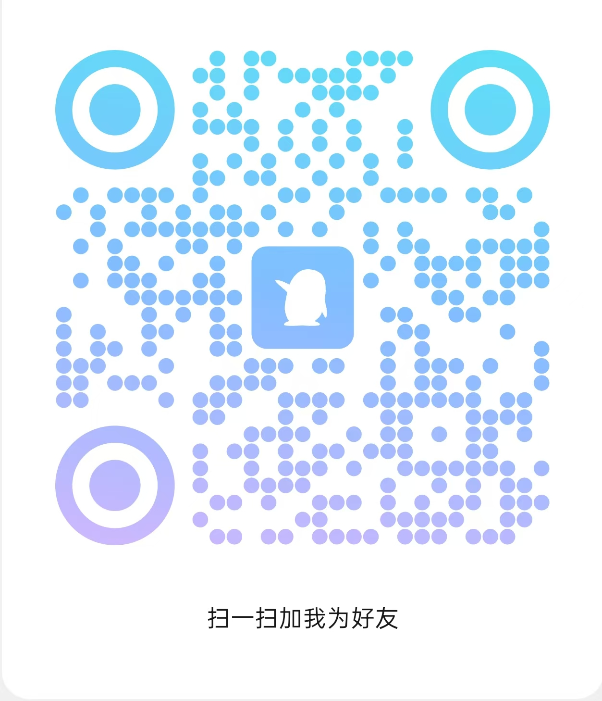

# 赢派互联网医院系统（YingPai Internet Hospital System）

> **互联网医院系统源码出售 · 定制开发 · 全流程陪跑**
>
> 作者 **QQ：2536811576** ｜ **微信：dynn2018**（支持一切合作方式：源码交付、定制开发、OEM 贴牌、渠道合作、联合出海）
>
> ✅ 协助通过**三级等保**测评　✅ 协助**互联网医院牌照申办**（申办流程辅导 · 材料梳理 · 省监管平台对接实施）　✅ 支持对接省级监管平台与院内 HIS/LIS/PACS
>
> 选型咨询 / 演示申请 / 商务合作，直接加微信或 QQ，注明「机构类型 + 区域」。

> 面向实体医疗机构与区域医疗集团的互联网医院整体解决方案
> 本仓库为产品能力白皮书与技术文档入口，持续更新。

## 一、产品定位

赢派互联网医院系统为**依托实体医疗机构开展互联网诊疗**的信息化平台，覆盖在线复诊、电子处方与流转、监管平台对接、院内系统集成全链路，提供 SaaS 云端、私有化部署、混合模式三种交付方案。

> 合规提示：依据《互联网诊疗管理办法（试行）》《互联网医院管理办法（试行）》（国卫医发〔2018〕25号），互联网诊疗活动须由取得《医疗机构执业许可证》的医疗机构提供，互联网医院执业登记由实体医疗机构依法向卫生健康行政部门申请。赢派定位为信息技术服务商，提供系统建设、监管平台对接实施与全流程陪跑服务。

## 二、行业背景（数据来源见文末）

- 截至 2026 年，全国共设置互联网医院 4349 家，2025 年诊疗服务人次 1.9 亿（国家卫健委 2026 年 11 月公开数据）。
- 互联网诊疗仅限部分常见病、慢性病**复诊**，系统必须支持全程留痕、可追溯，并向省级互联网医疗服务监管平台开放数据接口。
- 系统须按**信息安全等级保护三级**标准建设，核心诊疗数据存储于境内。

## 三、核心功能清单

| 模块 | 能力要点 |
|---|---|
| 在线诊疗 | 图文 / 语音 / 高清视频在线复诊，预约挂号，健康咨询，复诊条件校验 |
| 电子处方 | 处方开具、CA 电子签名、药师审核工作流、处方流转与第三方配送对接 |
| 监管对接 | 省级互联网医疗服务监管平台数据上报、诊疗全程留痕、日志与溯源 |
| 院内集成 | HIS / LIS / PACS 系统对接，诊疗数据完整回写院内电子病历，解决线上线下"两张皮" |
| 医务管理 | 医师资质校验（对接国家医师 / 护士电子注册系统）、电子实名认证、排班与号源管理 |
| AI 辅助 | 医师辅助提示、合理用药提醒；**严格不做 AI 自动生成处方**（合规红线） |
| 患者服务 | 检查检验报告在线查询、在线支付与医保接口适配（按地区政策）、随访管理 |
| 运营管理 | 业务数据看板、工作量统计、不良事件上报流程支持 |

详细模块说明见 [docs/功能清单与模块说明.md](docs/功能清单与模块说明.md)。

## 四、三种交付模式

| 模式 | 适用场景 | 特点 |
|---|---|---|
| SaaS 云端 | 快速上线的专科机构、门诊量较小的二级医院 | 账号开通即用，上线周期短 |
| 私有化部署 | 数据敏感的公立医院 | 系统买断，核心医疗数据院内留存、不出内网 |
| 混合模式 | 需要快速上线同时保留关键模块定制的机构 | SaaS 快速上线 + 敏感数据隔离与定制模块 |

## 五、合规与安全

- 按网络安全等级保护**三级**标准建设；
- 核心诊疗数据境内存储，支持数据脱敏、权限隔离、操作留痕、全程日志；
- 患者隐私保护与医疗数据保密要求全流程落实；
- 详见 [docs/合规与安全.md](docs/合规与安全.md)。

## 六、实施流程

1. 需求梳理与方案设计（结合医院功能定位与诊疗科目）
2. 系统部署与院内集成（HIS / LIS / PACS / 医保）
3. 省级监管平台对接联调
4. 等保测评配合与整改
5. 上线试运行与培训陪跑
6. 持续运维与政策合规跟踪

## 七、合作方式

- **医院机构**：提供选型咨询、方案设计与私有化 / SaaS 交付；
- **渠道商 / 集成商**：提供产品合作与二次开发支持，欢迎通过本仓库 Issues 洽谈；
- **海外市场**：面向东南亚、中东等市场的互联网医院系统出海交付（多语言、多币种、多时区、当地部署与合规适配），详见 [docs/海外市场与出海服务.md](docs/海外市场与出海服务.md)；
- 详细说明见 [docs/合作模式.md](docs/合作模式.md)。

## 八、行业内容（Blog）

围绕牌照申办、等级保护、监管对接与选型实施的实操文章，持续更新：

| 编号 | 标题 | 主题 |
|---|---|---|
| 01 | [2026 年互联网医院最新数据解读](blog/01-2026年互联网医院最新数据解读.md) | 行业数据与趋势 |
| 02 | [互联网医院牌照申请全流程](blog/02-互联网医院牌照申请全流程.md) | 牌照申办路径 |
| 03 | [互联网医院系统怎么选？医院信息科要核对的 12 项硬指标](blog/03-互联网医院系统怎么选？医院信息科要核对的12项硬指标.md) | 选型与避坑 |
| 04 | [互联网医院三级等保怎么过？从定级到测评的六个环节](blog/04-互联网医院三级等保怎么过.md) | 等保三级实施 |
| 05 | [省级监管平台对接怎么做？上报数据清单与联调踩坑](blog/05-省级监管平台对接怎么做：上报数据清单与联调踩坑.md) | 监管对接实施 |

## 九、联系方式

| 渠道 | 联系方式 |
|---|---|
| 微信 | dynn2018（扫码添加，见下方二维码） |
| QQ | 2536811576 |

  
  &nbsp;&nbsp;&nbsp;&nbsp;
  

左：微信 dynn2018　|　右：QQ 2536811576

> 咨询时请说明您的机构类型（医院 / 渠道商 / 集成商）与所在区域，以便更高效地对接。

## 数据来源

- 国家卫生健康委员会《关于全国政协十四届四次会议第04592号提案答复的函》（2026年11月，nhc.gov.cn）
- 《互联网诊疗管理办法（试行）》《互联网医院管理办法（试行）》《远程医疗服务管理规范（试行）》（国卫医发〔2018〕25号，gov.cn）

## 关键词

互联网医院系统、互联网医院解决方案、互联网医院平台搭建、互联网医院建设、互联网医院出海、医疗AI出海、海外互联网医院系统、东南亚数字医疗、中东数字医疗、多语言医疗系统、在线问诊系统、在线复诊系统、电子处方系统、处方流转、省级互联网医疗监管平台对接、HIS 对接、LIS 对接、PACS 对接、等保三级、SaaS 互联网医院、私有化部署、医院信息化、医疗信息化、YingPai Internet Hospital System

> 如果本仓库对您有帮助，欢迎 Star 收藏；选型咨询与合作请见上方「联系方式」。
